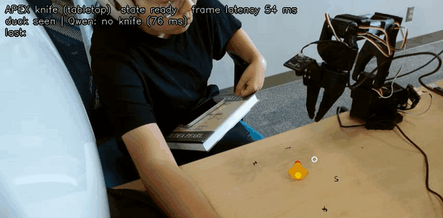
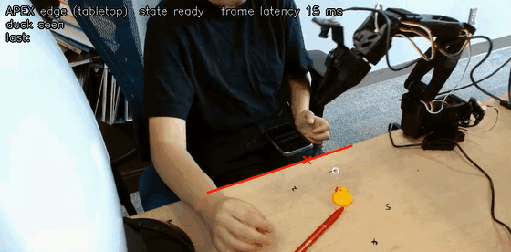

# APEX on a Real Robot

A predict-and-block safety layer for an SO-101 arm. A physics model forecasts the next few seconds, a graph network flags which pair of objects is about to go wrong, and Qwen3-VL picks where the gripper should go. The arm then gets in the way in time.

**Project page with all videos:** https://hwj20.github.io/apex-real/

| Knife pushed at the duck | Duck pushed toward the table edge |
|---|---|
|  |  |
| Hit forecast 3.8 s ahead; gripper in the path ~2 s before the predicted hit. | Fall forecast ~7 s ahead; gripper in place in under 1 s. |

Both GIFs are the overhead camera at 2× speed.

## Demos

| | Video | Storyboard |
|---|---|---|
| Real robot: knife | [mp4](media/SO101_fig2_APEX_knife_block.mp4) | [png](media/2_knife_en.png) |
| Real robot: table edge | [mp4](media/SO101_fig3_APEX_cliff_block.mp4) | [png](media/3_cliff_en.png) |
| Simulation: four scenarios, with vs. without APEX | [mp4](media/SO101_fig1_APEX_simulation_four_scenarios.mp4) | [png](media/1_sim_en.png) |
| Real robot: autonomous pick-and-place (USB stick into a bowl) | [mp4](media/SO101_pick_and_place_usb_into_bowl.mp4) | — |

In simulation every scenario gave the same outcome in 6 of 6 runs, including the control case where the right move is to do nothing.

## How APEX decides

Camera (colour finds the duck, Qwen3-VL the knife) → graph network flags the risky pair → physics model forecasts the next 4 s → try every reachable block point, keep the best 5 → Qwen3-VL picks one → check it truly blocks on the arm's real path, else take the next point → move in and hold while the threat lasts → lift 2.5 s after it ends.

## Paper

The real-robot work extends APEX:

> Wanjing Huang, Weixiang Yan, Zhen Zhang, Ambuj Singh. *APEX: Empowering LLMs with Physics-Based Task Planning for Real-time Insight.* arXiv:2505.13921, 2025. https://arxiv.org/abs/2505.13921

```bibtex
@article{huang2025apex,
  title   = {APEX: Empowering LLMs with Physics-Based Task Planning for Real-time Insight},
  author  = {Huang, Wanjing and Yan, Weixiang and Zhang, Zhen and Singh, Ambuj},
  journal = {arXiv preprint arXiv:2505.13921},
  year    = {2025}
}
```

## Contact

Wanjing Huang, UC Santa Barbara · wanjinghuang0310@gmail.com
